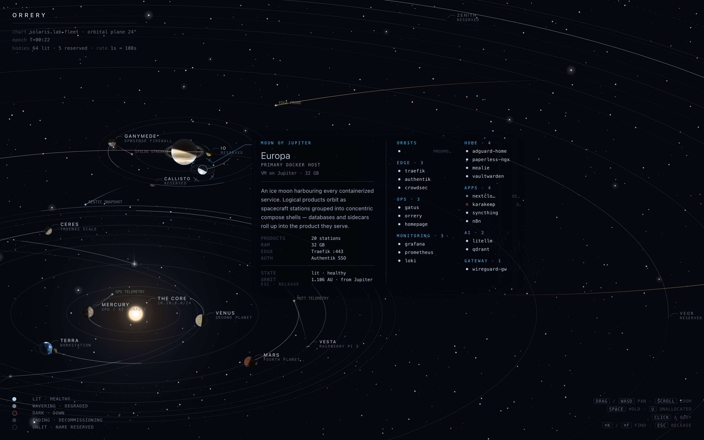
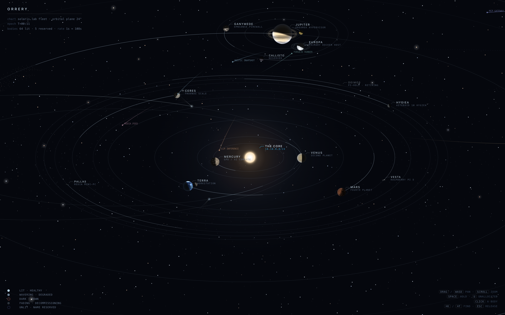
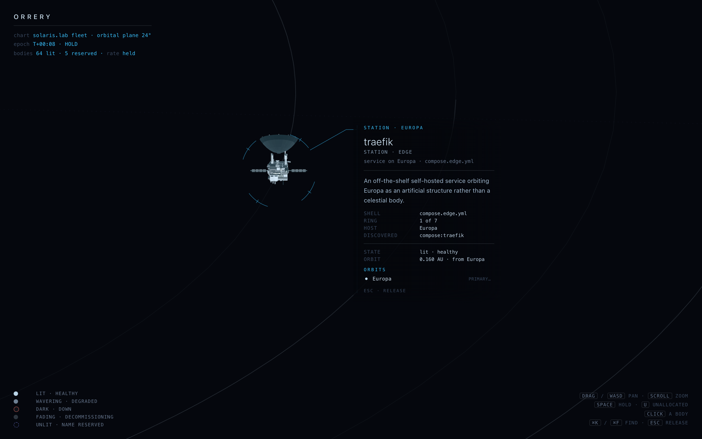
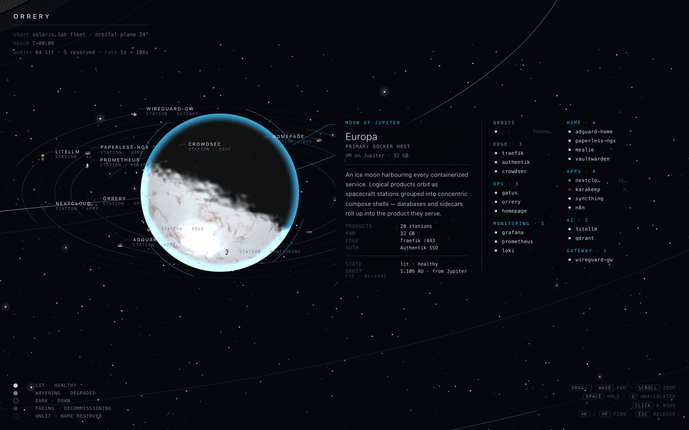
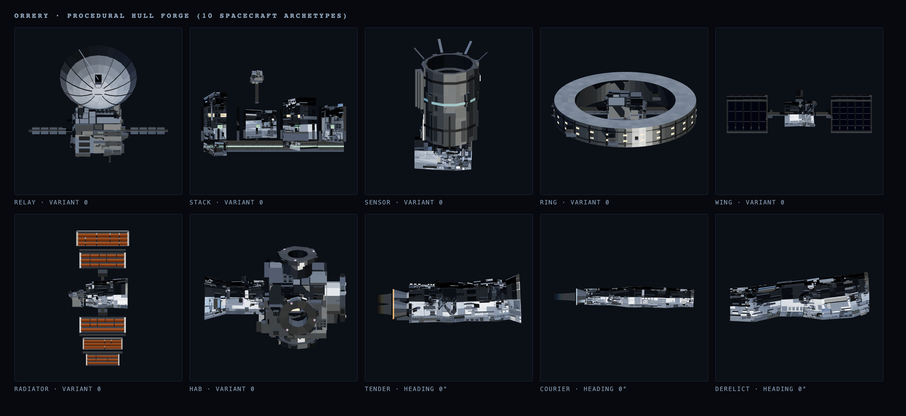

<div align="center">

# Orrery

**A live orbital star chart for your homelab fleet.**

*Layout is topology, not astronomy. State is expressed only as light.*

[](https://charlesbine.com/demos/orrery/)
[](LICENSE)
[](package.json)
[](package.json)
[](#security-first-auto-sync)

<br>



</div>

---

Not a dashboard. Launchers give you tiles to click; **Orrery is the map** — the
view that shows what your infrastructure *is*, how trust boundaries separate it,
how backups and gateways flow between hosts as interplanetary transfer ships,
and what is alive right now.

Explore the **[live interactive `solaris.lab` demo](https://charlesbine.com/demos/orrery/)**
in your browser (or read the [project tour & 1080p flythrough](https://charlesbine.com/projects/orrery/)).

It runs as zero-dependency static HTML/WebGL behind Caddy, backed by an optional
**networkless, read-only, zero-Docker-socket** sidecar that discovers your
services from Compose, Traefik, Caddy, Homepage, and Tailscale configuration.

---

## Why a Star Chart? (The Naming Philosophy)

Orrery isn't a sci-fi skin slapped onto a homelab — it grew directly out of how
I name my own machines. My rule is simple: **a name should earn its place by
pointing at the job, and follow a geography of distance**:

- **Close (LAN & core infra) → solar-system bodies.** Machines inside the house
  are planets, moons, and minor bodies matched to their role: hot GPU/AI compute
  closest to the sun (*Mercury*), bulk storage in the belt (*Ceres*), a
  container host harboring services like an ice moon hiding a subsurface ocean
  (*Europa*) orbiting its hypervisor (*Jupiter*), and small single-job appliances
  named after asteroids or luminous sky phenomena.
- **Boundary (skinny-ACL tailnet edge) → outer-system / Kuiper bodies.** Nodes
  sitting on the boundary between inside and outside — like an isolated
  agent-hosting VPS behind a tight tailnet ACL — live at the outer edge
  (*Charon*, the ferryman between worlds).
- **Far & less trusted (off-tailnet VPSes) → beyond the heliopause.** Anything
  that lives outside the house and **off the tailnet** — public-facing VPSes or
  untrusted edge boxes — sits **outside the heliopause** among the interstellar
  stars (*Polaris*, the fixed beacon ships navigate to). You can read your trust
  perimeter at a single glance.
- **Machines carry the theme; services stay legible.** Off-the-shelf software
  always keeps its real product name (`traefik`, `grafana`, `gatus`,
  `vaultwarden`) — renaming infrastructure apps just creates debugging
  confusion. Hosts get celestial names; the stations orbiting them stay
  unmistakable.

*(Orrery works with any hostnames you already use via `orrery import --tailscale`
or Compose discovery — you don't need to adopt celestial hostnames to run it,
though the map feels right at home if you do.)*

---

## The Two Ideas It Rests On

### 1. Layout is topology, not astronomy
Orbital radius encodes **trust distance** — from your core LAN planets out
through tailnet boundary nodes, across the **heliopause**, and into interstellar
space for less-trusted or off-tailnet VPSes. Real astronomical coordinates would
collapse inner infrastructure and untrusted edge nodes together, so Orrery
renders real procedural planets, moons, rings, asteroid belts, comets, and
beyond-heliopause stars over a **collision-solved topological layout**.

Every orbit (`a`, `e`) and the heliopause boundary are solved mathematically by
[`dev/layout.js`](dev/layout.js) using confocal ellipse nesting and audited across
every gravitational frame by [`dev/clearance.js`](dev/clearance.js).

### 2. State is expressed only as light
There is not a single green badge or traffic-light pill anywhere in the chart:

| Visual | State | Meaning |
|---|---|---|
| **Lit** | `ok` | Healthy — catching the sun cleanly |
| **Wavering** | `degraded` | Split monitor verdict (e.g. web UI up, background worker failing) |
| **Dark** | `down` | Unreachable — still in orbit, no longer catching the sun |
| **Fading** | `fading` | Decommissioning — kept on the chart until actually retired |
| **Unlit** | `reserved` | Empty orbit holding a reserved name for future hardware |

---

## Visual Tour

### Interplanetary Transfer Ships — Backups, Gateways & Telemetry in Motion
Cross-host traffic isn't hidden in static arrows — recurring flows travel across
the system as color-coded **interplanetary transfer ships** arcing between their
origin and destination hosts. Backups (`Restic`, `ZFS` replication, off-site
mirrors), `MCP` gateway & tool-verdict traffic, `LLM` inference calls, CI
runners, and telemetry streams each carry a muted orbital hue and fading trail,
and every ship is clickable and searchable via `⌘K`. Define your own routes in
`SHIPS` in [`src/fleet.js`](src/fleet.js).



### Procedural 3D Spacecraft Hulls — Impostors Far, Real Meshes Near
Services are **stations**, not planets. At wide zoom they orbit their host in
concentric shells as baked normal-mapped sprites; zoom in past the threshold and
Orrery seamlessly switches to real-time flat-shaded 3D WebGL meshes generated
from the exact same procedural geometry.



### Concentric Compose Shells & Light-as-State
A Docker host's services arrange into concentric rings by compose stack
(`edge`, `ops`, `monitoring`, `home`, `apps`, `ai`, `gateway`). One station
equals one **logical product** — databases, Redis caches, and sidecar workers
roll up into the service they serve. Click any host or station to inspect its
orbit, shell membership, and live health verdicts.



### Ten Procedural Hull Archetypes
Each compose shell maps to a distinct spacecraft silhouette — `relay` dishes for
edge proxies, `stack` spines for ops, `sensor` booms for observability, rotating
`ring` wheels for home services, solar `wing` arrays for apps, glowing
`radiator` fins for AI compute, `hab` docking hubs for gateways, plus three
heading-aligned `craft` classes (`tender`, `courier`, `derelict`) for minor
nodes and retiring appliances.



---

## 60-Second Quick Start

### 1. Try the interactive demo locally (zero build step, zero `npm install`)

```sh
git clone https://github.com/charlesbine/orrery.git
cd orrery
python3 -m http.server 8080
```

Open **`http://localhost:8080/src/`** in your browser — or open the
self-contained single-file snapshot [`orrery.html`](orrery.html) directly.

### 2. Drop into your homelab with Docker Compose

```sh
docker compose up -d
```

Open **`http://127.0.0.1:8080`**. By default, `docker-compose.yml` binds
loopback-only (`127.0.0.1:8080`) so you can place it behind your existing
reverse proxy (Traefik, Caddy, Nginx, or Tailscale Serve).

### 3. Bootstrap your own fleet in two commands

Import your Tailscale nodes (automatically grouped into trust rings with
collision-free orbits) and sync your Docker Compose services:

```sh
# Bootstrap hosts & trust rings from your tailnet (or pass --file status.json)
node bin/orrery.js import --tailscale --write --config orrery.config.json

# Discover services, solve orbits, and generate src/services.generated.js
node bin/orrery.js sync --config orrery.config.json
```

---

## Security-First Auto-Sync

Most homelab dashboards ask for `/var/run/docker.sock` (effectively root on the
host) and broad API tokens. **Orrery takes the opposite posture:**

- **`network_mode: none`** — `orrery-sync` has no network interface at all.
- **`read_only: true` + `cap_drop: [ALL]` + `no-new-privileges`** — immutable
  container rootfs with zero Linux capabilities.
- **Zero Docker socket** — never talks to the Docker daemon.
- **Zero `.env` or secret reads** — mount only the specific non-secret Compose,
  Traefik, or Gatus YAML files you want parsed (`:ro`).
- **Atomic swap** — writes to a temp file and `rename()`s into the shared
  `orrery-generated` volume so the static server never serves a half-written
  roster.
- **Same-origin status proxy** — Caddy can optionally proxy your read-only
  status endpoint at `/api/status` so the browser receives zero credentials and
  zero cross-origin permissions. Because Gatus responses include endpoint
  hostnames, conditions, and error details, keep `/api/status` behind the same
  authentication layer as Orrery itself.

---

## Configuring `orrery.config.json`

Orrery's auto-importer (`bin/orrery.js` / `dev/sync.js`) is driven by a single
JSON config file. Both `dynamicTraefikFile` and `gatusFile` are **strictly
optional** — omit them or point to a file that doesn't exist and Orrery skips
them cleanly without throwing `ENOENT`.

```json
{
  "version": 2,
  "fleet": {
    "name": "my-homelab",
    "title": "Orrery — my-homelab",
    "chart": "my-homelab fleet · orbital plane 24°",
    "status": {
      "adapter": "auto",
      "url": "/api/status",
      "selfId": "svc-docker-gatus",
      "intervalMs": 30000
    }
  },
  "defaultHost": "docker",
  "discovery": {
    "mode": "routed",
    "composeFiles": [
      { "path": "compose.edge.yml", "host": "docker", "shell": "edge" },
      { "path": "compose.apps.yml", "host": "docker", "shell": "apps" },
      { "path": "compose.media.yml", "host": "media-box", "shell": "apps", "mode": "all" }
    ],
    "dynamicTraefikFile": "traefik/services.yml",
    "gatusFile": "gatus/config.yaml"
  },
  "excludeSources": ["dynamic:router-ui"],
  "sourceOverrides": {
    "dynamic:minio-web": { "product": "minio", "name": "minio", "host": "nas" },
    "dynamic:minio-s3":  { "product": "minio", "name": "minio", "host": "nas" }
  },
  "productOverrides": {
    "nextcloud": { "health": [["Apps", "nextcloud"], ["Apps", "nextcloud cron"]] }
  },
  "extraProducts": [
    { "product": "loki", "host": "docker", "shell": "monitoring" }
  ]
}
```

### Discovery modes & label dialects
Set `"mode"` globally under `discovery` or per file in `composeFiles`:

- **`"routed"`** *(default)* — Discovers services carrying any of:
  - **Traefik**: `traefik.http.routers.<name>.rule=...` (honors `traefik.enable=false`)
  - **Caddy Docker Proxy**: `caddy`, `caddy_<n>`, or `caddy.reverse_proxy`
  - **Homepage**: `homepage.name`, `homepage.href`, or `homepage.group`
  - **Orrery native**: `orrery.enable=true` or `orrery.product=<name>`
- **`"all"`** — Discovers every service declared in the Compose file (ideal for
  Compose-only stacks with no reverse proxy labels).

Any service can carry optional native labels in Compose:
- `orrery.ignore=true` — Exclude sidecars, databases, or init containers
- `orrery.product=<slug>` — Merge multiple containers into one logical station
- `orrery.name=<label>` — Display name override
- `orrery.host=<hostId>` / `orrery.shell=<shell>` — Override placement
- `orrery.state=ok|degraded|down|fading` — Static bootstrap state

### Pluggable Health / Status Adapters
Configure `fleet.status.adapter` to drive station light from live checks:

- **`"gatus"`** — Polls Gatus's read-only `/api/v1/endpoints/statuses` (proxied
  at `/api/status`). Gatus status payloads expose endpoint hostnames,
  conditions, and error details, so `/api/status` should sit behind the same
  authentication layer as Orrery rather than being exposed publicly. When
  `gatusFile` is mounted, `orrery sync` validates every
  `health: [[group, name]]` reference loudly at sync time. Multiple monitors per
  product automatically synthesize `ok` (all pass), `degraded` (split verdict),
  and `down` (all fail).
- **`"generic"`** — Polls any JSON endpoint returning either
  `{ "services": { "jellyfin": "ok", "nextcloud": "degraded" } }`, a flat
  `{ "jellyfin": true }` map, or an array of
  `{ "name": "jellyfin", "host": "pallas", "state": "ok" }`.
- **`"auto"`** *(default)* — Auto-detects Gatus vs. generic JSON payloads.
- **`"static"` / `"none"`** — Disables live polling completely; lights follow
  static states from your fleet/config.

If the status endpoint itself fails or times out, Orrery preserves the last
known lights so a monitor outage never impersonates a fleet-wide outage.

---

## CLI Reference

```sh
# Sync services & solve collision-free orbits from orrery.config.json
node bin/orrery.js sync [--config orrery.config.json] [--root .] [--output src/services.generated.js]
node bin/orrery.js sync --check              # CI / drift check (exits non-zero if stale)
node bin/orrery.js sync --watch              # Continuous watch worker (used in Docker)

# Bootstrap hosts & trust rings from Tailscale
node bin/orrery.js import --tailscale [--file status.json] [--write --config orrery.config.json]
node bin/orrery.js import --tailscale --file status.json --out hosts.json

# Solve collision-free orbits for a hand-authored src/fleet.js
node bin/orrery.js layout [--write]

# Build or check the single-file orrery.html snapshot
node bin/orrery.js bundle [--check]

# Run all static checks (GLSL, clearance, 120-frame smoke, bundle freshness)
node bin/orrery.js check
```

---

## Private Fleet Overlays

You should never need to commit private hostnames, internal IPs, or personal
topology into a public fork of Orrery. Keep your real homelab definition in your
private infrastructure repository and overlay it onto the stock Orrery image at
runtime:

```yaml
services:
  orrery:
    image: orrery:local
    read_only: true
    volumes:
      - orrery-generated:/srv/generated:ro
      - ./orrery/fleet.js:/srv/fleet.js:ro       # optional custom hand-authored celestial roster
      - ./orrery/Caddyfile:/etc/caddy/Caddyfile:ro  # optional same-origin /api/status proxy to Gatus

  orrery-sync:
    image: orrery-sync:local
    network_mode: none
    read_only: true
    volumes:
      - ./orrery/orrery.config.json:/config/orrery.config.json:ro
      - ./compose.edge.yml:/config/compose.edge.yml:ro
      - ./compose.apps.yml:/config/compose.apps.yml:ro
      - ./traefik/services.yml:/config/traefik/services.yml:ro
      - ./gatus/config/config.yaml:/config/gatus/config.yaml:ro
      - orrery-generated:/generated:rw
```

Because `orrery-sync` injects `ORRERY_SYNC` (metadata, optional config-defined
`hosts`, solved orbits, and `HELIOPAUSE`) into `/generated/services.js` and
`Caddyfile` resolves `/services.generated.js` via
`try_files /generated/services.js /services.generated.js`, most private setups
only need to mount `orrery.config.json` and their non-secret YAML files — no
forking or rebuilding required.

---

## Controls

| Input | Action |
|---|---|
| `drag` / `WASD` / arrows | Pan across the orbital plane |
| `scroll` | Zoom (from whole heliopause down to individual 3D hull meshes) |
| `click` | Focus a body, station, or transfer craft and open its readout |
| `space` | Hold / resume simulated time (eased ramp) |
| `u` | Toggle unallocated solar system ghost bodies |
| `⌘K` / `⌘F` (or `Ctrl+K` / `Ctrl+F`) | Fuzzy-find any body, station, transfer, or layer action + live frame diagnostics |
| `esc` | Release focus / close command menu |
| `#body-id` URL hash | Deep-link directly to any body, station, or ship (e.g. `#europa`, `#svc-europa-traefik`) |

---

## Development & Verification

Orrery has **zero runtime or build dependencies** — Node 18+ runs every check
natively:

```sh
npm run verify      # Runs all five checks below
npm run glsl        # Static GLSL identifier & uniform stage verification
npm run clearance   # Zoom-invariant collision audit across all gravitational frames
npm run smoke       # Headless 120-frame renderer & empty-path draw check
npm run bundle:check # Ensures single-file orrery.html matches src/
npm test            # Auto-importer, Tailscale, solver, and status adapter unit tests
```

Inspect individual procedural hulls in your browser by serving the repo root and
opening `dev/forge.html?only=all&n=2` or `dev/contact.html`.

---

## License

[MIT](LICENSE)
